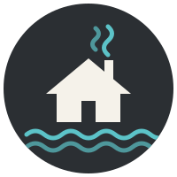

# Mood board: Kuivasjärven Rantasaunat

## Feeling

**Relaxation, calm, health.**

- **Relaxation:** Lots of space, one big photo, no busy elements. Motion is minimal and off with reduced motion.
- **Calm:** Quiet charcoal, off-white and lake teal, like dusk by the lake.
- **Health:** Clean and fresh, no medical claims. Strong contrast, visible focus, words as well as colour.

## Colours

60 · 30 · 10: off-white or night (60), charcoal and slate (30), lake teal (10). The warm wood tones of the photo are the complementary accent to the teal, used only through the photo.

| Name | Hex | Used for |
|---|---|---|
| Charcoal | `#2B2F33` | Text, footer, borders |
| Slate | `#36454F` | Navbar |
| Off-white | `#F5F2EA` | Light background, cards |
| Deep lake teal | `#1B6B70` | Headings, buttons (light) |
| Light lake teal | `#5CC3C8` | Accent line, focus, headings and buttons (dark) |
| Night | `#1F2326` | Dark background |

Contrast of main text on background: **12.1 : 1** (light), **14.1 : 1** (dark). Headings: 5.5 : 1 (light), 7.6 : 1 (dark). All text pairs are at least 4.5 : 1.

## Fonts

- **Headings:** Georgia, serif. Warm, fits the logo.
- **Text:** system-ui, sans-serif. Readable, nothing to download, no Google Fonts (GDPR).

## References

- [Kangasjärvi private sauna](https://visitseinajokiregion.fi/?p=33505): clear booking rules and contact.
- [Ruka private smoke sauna](https://www.ruka.fi/en/node/3326): list of what is included, price per group.
- [Ikaalinen Spa smoke sauna](https://ikaalinenspa.fi/en/swimming-saunas/smoke-sauna): price in one sentence, photo gallery.